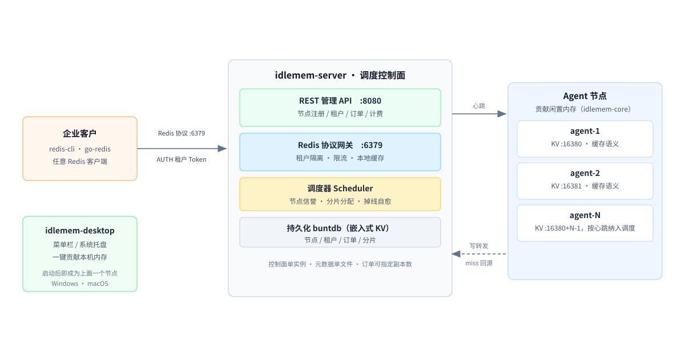

# idlemem-desktop

闲存云 Agent 的**桌面外壳**仓库：Windows 系统托盘 + macOS 菜单栏应用。

它把 [idlemem-core](https://github.com/renzhiyong1680-code/idlemem-core) 核心库装配成一个常驻托盘进程，节点主人无需命令行即可管理自己的"闲置内存贡献节点"。

本仓库是三个仓库中的**供给方外壳**。另外两个：[idlemem-core](https://github.com/renzhiyong1680-code/idlemem-core)（贡献节点核心库）、[idlemem-server](https://github.com/renzhiyong1680-code/idlemem-server)（调度控制面）。项目定位、**明确不做什么**、能力边界与当前进度，见 [项目介绍](https://github.com/renzhiyong1680-code/idlemem-core/blob/master/docs/%E9%A1%B9%E7%9B%AE%E4%BB%8B%E7%BB%8D.md)。

> 只想立刻贡献内存：下载 [v0.1.1 的托盘程序](https://github.com/renzhiyong1680-code/idlemem-desktop/releases/tag/v0.1.1)，运行后连上控制面即可，无需编译。

## 下载后怎么打开（会被系统拦一次，属正常）

`v0.1.1` 的托盘程序**没有做代码签名**，所以首次运行系统会拦。拦的是"发布者未验证"，不是程序有问题。

**macOS**：把下载的 `xiancun-tray` 放进任意目录，然后

```bash
chmod +x ./xiancun-tray
xattr -d com.apple.quarantine ./xiancun-tray
./xiancun-tray
```

也可以在 Finder 里按住 `Control` 点图标 → 打开 → 弹窗里再点「打开」。若仍提示"无法验证开发者"，去**系统设置 → 隐私与安全性**，底部会有一条拦截记录，点「仍要打开」。

**Windows**：双击 `xiancun-tray.exe`，SmartScreen 弹「Windows 已保护你的电脑」时点「更多信息」→「仍要运行」。

想彻底消除拦截只能买证书：macOS 需要 Apple Developer 账号（99 美元/年）做 `codesign` + `notarize`，Windows 需要 OV/EV 代码签名证书。当前版本没做，是成本取舍，不影响功能。

## 三仓如何协作



本仓库提供的是最后一公里：把 `idlemem-core` 的 agent 与 kvsrv 装配成常驻托盘进程，让普通用户不用命令行就能成为上面图里的一个 Agent 节点。


## 功能

- **状态一瞥**：托盘菜单实时显示贡献状态（在线/暂停）、贡献容量、KV 占用、key 数、KV 端口与控制面地址；
- **手动暂停/恢复贡献**：一键开关，优先级高于内存压力判定（对核心库 `governor.SetEnabled` 的调用）；
- **优雅退出**：关闭 KV 端口并停止心跳上报；
- **跨平台同一份代码**：`getlantern/systray` 驱动，Windows/macOS 共用 `cmd/xiancun-tray`。

## 构建

```bash
# Windows（需要 CGO 工具链，如 WinLibs gcc）
CGO_ENABLED=1 go build -o xiancun-tray.exe ./cmd/xiancun-tray

# macOS（在 mac 上构建）
CGO_ENABLED=1 go build -o xiancun-tray ./cmd/xiancun-tray
```

> 说明：systray 依赖平台原生 GUI API（Windows Win32 / macOS Cocoa），因此必须开启 CGO，且 macOS 版需在 mac 上编译。CLI 外壳 `xiancun-agent` 仍是零依赖纯标准库，可在任意平台交叉编译。

## 运行

```bash
# 默认连 http://127.0.0.1:8080，KV 端口 :16380
xiancun-tray.exe

# 指定控制面与 KV 端口
xiancun-tray.exe -server http://1.2.3.4:8080 -kv :16380 -interval 10s

# 用 JSON 配置文件（字段与 cmd/xiancun-agent 一致）
xiancun-tray.exe -config tray.json
```

## 托盘菜单

```
闲存云 Agent            （图标：蓝底"闲"字）
├─ 状态：online　贡献 12.6GB　占用 0.1GB　keys 3
├─ KV 端口：:16380
├─ 控制面：http://127.0.0.1:8080
├─────────────────────
├─ 暂停贡献 / 恢复贡献
└─ 退出
```

## 与三端外壳的关系

| 外壳 | 形态 | 仓库 |
|---|---|---|
| CLI | 命令行 / systemd 守护 | `idlemem-core/cmd/xiancun-agent` |
| Windows 托盘 | 系统托盘 | 本仓库 `cmd/xiancun-tray` |
| macOS 菜单栏 | 菜单栏图标 | 本仓库 `cmd/xiancun-tray` |

## 架构

```
┌─────────────────────────────────────────────┐
│  xiancun-tray（本仓库）                       │
│   systray 菜单/图标 + 配置加载 + 生命周期装配   │
├─────────────────────────────────────────────┤
│  idlemem-core v0.1.1（模块依赖）             │
│   agent（整合入口）+ kvsrv（RESP 端口）        │
│   + governor（手动暂停开关）+ heartbeat       │
└─────────────────────────────────────────────┘
```

## 已知限制

- **macOS 只做了构建验证，没有做真机交互验证**。菜单栏图标、暂停/恢复、状态刷新这些交互在真机上还没点过一遍，试用反馈请开 Issue。
- **macOS 产物架构以 CI 日志为准**。构建机是 Apple Silicon（arm64），Release 上的 `xiancun-tray` 因此是 arm64 二进制；Intel Mac 需要在本机 `go build` 自行编译（`CGO_ENABLED=1`）。
- **没有代码签名**，Windows 与 macOS 都会拦一次，处理方式见上文。
- **不持久化**：托盘崩溃或重启，贡献节点上的缓存数据即失效，这是设计前提，不是缺陷。

## 开发

```bash
git clone https://github.com/renzhiyong1680-code/idlemem-desktop.git
cd idlemem-desktop
# 核心库按版本号自动拉取（idlemem-core v0.1.1），无需同级目录
go vet ./...
```

## 许可证

本项目采用 **GNU Affero General Public License v3.0**（AGPL-3.0）授权，全文见 [LICENSE](LICENSE)。

- **网络服务义务**：任何通过网络向他人提供本项目（或其修改版）服务的部署，都必须向使用者提供对应的完整源码。
- **商业授权**：如需在闭源产品中集成，或需要免除 AGPL-3.0 的开源义务，可另行取得商业授权，细则见 [COMMERCIAL.md](COMMERCIAL.md)。
- **历史版本**：`v0.1.0` 及更早版本按 MIT 许可证发布，该授权不可撤销；AGPL-3.0 自 `v0.1.1` 起适用。

## 贡献

本项目采用 AGPL-3.0 与商业授权并行的双许可模式，因此对贡献的权利链有明确要求。提交拉取请求前，请阅读 [CLA.md](CLA.md)，并在 PR 模板中勾选确认。

- 贡献者保留自己贡献的著作权，仅授予项目方永久、全球、免费的许可，允许项目方在开源与商业授权两种模式下使用。
- 未确认 CLA 的拉取请求不会被合并。
- 提交前请先开 Issue 说清要解决的问题，避免大改动方向不符。

---

**闲存云 · 把闲置的内存变成可收益的资源**
